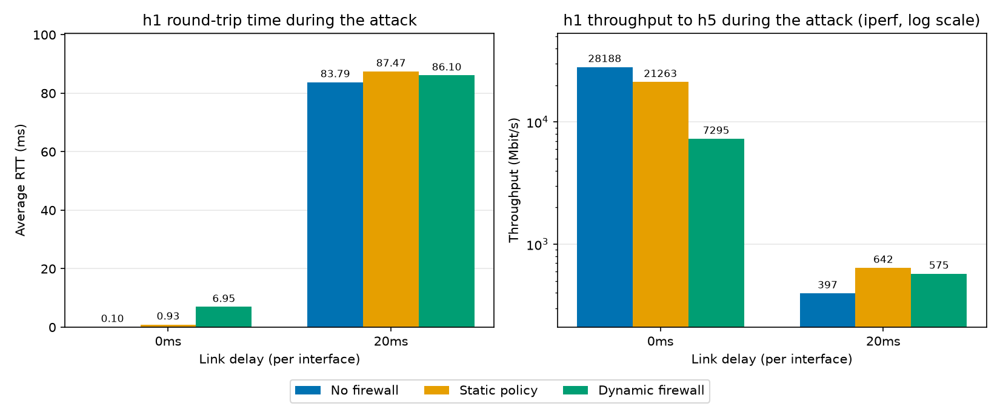
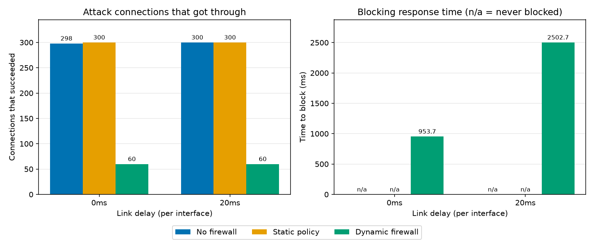

# Architecture

## 1. Objective

An SDN-based dynamic firewall. An OS-Ken controller watches the traffic of a
TCP socket application, installs allow, deny and block flow rules on an Open
vSwitch at runtime, and sends every security event to a central TCP logger.

## 2. Topology

```
                     VM root namespace
              +--------------------------------+
              |  OS-Ken controller             |
              |  (firewall)                    |
              |  10.0.0.254/24  (root-eth0)    |
              +---------------+----------------+
                              | extra link (s1-eth3 side shown on s1)
                              |
   h1 10.0.0.1 --+            |
   h2 10.0.0.2 --+            |
   h3 10.0.0.3 --+--------- [ s1 ] OVS, OpenFlow 1.3
   h4 10.0.0.4 --+  attacker   |
   h5 10.0.0.5 --+  app server |
   h6 10.0.0.6 --+  logger     |

   OpenFlow control channel: s1 <-> controller, 127.0.0.1:6653
```

- h1-h3 are normal clients, h4 is the attacker, h5 runs the app server, h6
  runs the logger.
- The controller runs in the VM's root namespace, which Mininet hosts cannot
  reach by default. The extra link from the root namespace to s1 gives it the
  address 10.0.0.254/24 inside the host subnet. This was verified (test T0 in
  `tests/README.md`).
- /24 is used instead of /8 so the route does not overlap the VM's NAT
  network 10.0.2.0/24.

## 3. Components

| Component       | File (planned)                  | Role |
|-----------------|---------------------------------|------|
| App server      | `app/server.py` (h5)            | TCP server on port 5000. Authenticates users, echoes messages, reports failed logins to the controller. |
| Client          | `app/client.py` (h1-h4)         | Normal mode: logs in and sends messages. Attack mode: connection flood or repeated bad logins. |
| Logger server   | `logger/logger_server.py` (h6)  | TCP server on port 6000. Receives JSON events and appends them to a log file. |
| Firewall controller | `controller/firewall.py`    | OS-Ken app. Learns forwarding, applies static policy, detects attacks, installs and expires block rules, sends events to the logger. |
| Topology script | `topology/topology.py`          | Builds s1, h1-h6 and the root link. Run with `sudo python3`. |

Static policy is read from `controller/policy.json`.

## 4. Communication

| From -> To                  | Protocol / port | Purpose |
|-----------------------------|-----------------|---------|
| client <-> app server       | TCP 5000        | Application traffic |
| controller -> logger        | TCP 6000        | Security events |
| app server -> controller    | TCP 7000        | Failed-login reports |
| switch <-> controller       | OpenFlow 1.3, 6653 | Flow rules, packet-in, flow-removed |

The controller connects to the logger at 10.0.0.6 and listens for the app
server's reports on 10.0.0.254:7000, both over the root link.

## 5. Message formats

All messages are one line terminated by `\n`.

**Application protocol (port 5000)**

| Client sends        | Server replies                  |
|---------------------|---------------------------------|
| `AUTH <user> <pass>`| `OK` or `ERR bad_credentials`   |
| `MSG <text>`        | `ECHO <text>` (only after AUTH) |
| `QUIT`              | connection closed               |

A `MSG` before a successful `AUTH` is rejected with an `ERR` line.

**Events and reports (ports 6000 and 7000)**: one JSON object per line:

```
{"ts": 1730000000.5, "source": "controller", "event": "BLOCK",
 "src_ip": "10.0.0.4", "reason": "flood", "detail": "27 new connections in 5 s"}
```

Fields: `ts`, `source`, `event`, `src_ip`, `reason`, `detail`.
Event types: `ALLOW`, `DENY`, `BLOCK`, `UNBLOCK`, `AUTH_FAIL`.

## 6. Firewall logic

- **Allow**: traffic that matches no deny or block rule is forwarded normally
  (learning-switch behaviour).
- **Deny (static)**: rules loaded from `controller/policy.json` when the
  controller starts, for example drop TCP port 23, drop traffic from 10.0.0.3
  to 10.0.0.6.
- **Block (dynamic)**: a source IP is blocked when either
  - it opens more than 20 new connections in 5 seconds (counted from
    packet-in of TCP SYN packets), or
  - the app server reports more than 3 failed `AUTH` attempts from it.

  The controller installs a drop rule matching that source IP with
  `hard_timeout` = 30 s. When the rule expires the switch sends a
  flow-removed message and the controller logs `UNBLOCK`.

Every decision (`ALLOW`, `DENY`, `BLOCK`, `UNBLOCK`) and every reported
failed login (`AUTH_FAIL`) is sent to the logger.

## 7. Flow rule priorities

| Priority | Rule |
|----------|------|
| 0        | Table-miss: send to controller |
| 1        | Learned forwarding (per src/dst MAC and port) |
| 50       | Static deny rules |
| 100      | Dynamic block rules |

The higher priority wins, so a block overrides a deny, which overrides normal
forwarding.

## 8. Demo scenarios

1. **Normal traffic**: h1-h3 log in and exchange messages with h5; events are
   logged as `ALLOW`.
2. **Denied port**: a client tries TCP port 23; the static rule drops it and
   `DENY` is logged.
3. **Flood attack**: h4 opens many connections quickly; the controller blocks
   10.0.0.4 for 30 s, then `UNBLOCK` is logged.
4. **Brute-force login**: h4 sends repeated wrong passwords; the app server
   reports `AUTH_FAIL` events and the controller blocks h4.
5. **Logger crash and reconnect**: stop the logger on h6 during traffic; the
   controller keeps enforcing rules, buffers events, reconnects and delivers
   them when the logger returns.

## 9. Performance Evaluation

**Question.** How well does the dynamic firewall protect a normal client
(h1) from a connection flood (h4), compared with having no firewall and with
a static policy only, and how quickly does it react?

**Setups** (the controller that is running):

| Label         | Controller                                   | Behaviour |
|---------------|----------------------------------------------|-----------|
| `no_firewall` | `controller/learning_switch.py`              | Plain forwarding, no policy, no blocking |
| `static`      | `controller/firewall.py` with `FW_DYNAMIC=0` | Static deny rules and per-connection rules, no flood or login blocking |
| `dynamic`     | `controller/firewall.py`                     | Static rules plus dynamic blocking |

**Conditions.** Every setup is run at two link delays: 0 ms (no shaping) and
20 ms. The delay is applied to every link interface, so a packet between h1
and h5 crosses two shaped interfaces in each direction and the round trip is
about four times the configured value (about 80 ms at 20 ms).

**Workload** (`experiments/run_experiment.py`):

1. *Baseline:* h1 runs a normal client session of 30 messages to h5 and an
   iperf TCP test to h5 for 5 s.
2. *Under attack:* h4 starts a connection flood against h5 (300 new TCP
   connections). While it runs, h1 repeats the same two measurements.

**Metrics** (one row per run in `results/results.csv`):

| Column | Meaning |
|--------|---------|
| `baseline_rtt_ms`, `attack_rtt_ms` | h1 average round-trip time per message, without and with the attack |
| `baseline_mbps`, `attack_mbps` | h1 iperf throughput to h5, without and with the attack |
| `attack_conns_succeeded` | Attack connections that completed the TCP handshake (out of 300) |
| `block_response_ms` | Time from the start of the attack to the controller's first BLOCK event for 10.0.0.4 (empty when nothing blocks) |

**Procedure.** Start the controller for the setup, then run
`sudo python3 experiments/run_experiment.py --label <label> --delay <delay>`.
Charts are produced with `python experiments/plot_results.py`. Exact commands
are in `experiments/README.md`.

**Expected outcome.** The dynamic firewall should let through only about 20
attack connections per block period (its limit is 20 new connections in 5 s)
while the other two setups let all 300 through. The effect on h1's RTT and
throughput was expected to be largest for the setups that do not block; how
large it is in this VM was to be measured.

**Results** (one run per row, from `results/results.csv`).

| Setup | Delay | h1 RTT base / attack (ms) | h1 Mbit/s base / attack | Attack conns succeeded | Block response (ms) |
|-------|-------|---------------------------|-------------------------|------------------------|---------------------|
| no_firewall | 0 ms  | 0.47 / 0.10   | 29708 / 28188 | 298 | n/a |
| static      | 0 ms  | 0.53 / 0.93   | 25205 / 21263 | 300 | n/a |
| dynamic     | 0 ms  | 1.85 / 6.95   | 6360 / 7295   | 60  | 953.7 |
| no_firewall | 20 ms | 83.85 / 83.79 | 411 / 397     | 300 | n/a |
| static      | 20 ms | 88.59 / 87.47 | 850 / 642     | 300 | n/a |
| dynamic     | 20 ms | 88.81 / 86.10 | 702 / 575     | 60  | 2502.7 |



*Figure 1. h1's average round-trip time and iperf throughput while h4 floods
h5, for each setup and delay (throughput axis is logarithmic).*



*Figure 2. Attack connections that completed (out of 300) and the time the
dynamic firewall needed to block h4.*

**Analysis.**

- **The flood was cut by about 80%.** With no firewall or a static policy
  almost all 300 attack connections succeeded (298 to 300). With the dynamic
  firewall only 60 did, at both delays.
- **Why 60 and not 20.** The attack ran for about 75 to 79 s and a block
  lasts 30 s. The attacker was blocked after about 20 connections, the rule
  expired by itself, it got another 20 through, was blocked again, and so on:
  about three block/recover cycles of roughly 20 connections each. This shows
  the automatic recovery (hard timeout plus flow-removed notification) working
  repeatedly, and that the firewall keeps limiting a persistent attacker
  instead of only blocking it once.
- **Blocking response time: 953.7 ms at 0 ms delay and 2502.7 ms at 20 ms.**
  Most of this is the time the attacker needs to reach the threshold (21 new
  connections in 5 s), not the controller's processing time. The attacker
  opens connections one after another, and each must wait for the TCP
  handshake. At 0 ms it manages roughly 22 connections per second; at 20 ms
  the longer round trip slows it to about 8 to 9 per second, so the threshold
  is reached later.
- **h1's RTT and throughput: no clear difference.** The differences between
  setups are small and within the noise of a VM; with one run per
  row nothing firm can be concluded. For example, throughput without any
  attack already differs between setups at the same delay (411, 850 and 702
  Mbit/s at 20 ms), which is as large as any change caused by the attack. The
  RTT at 20 ms stays between 83.8 and 88.8 ms in every case. The one larger
  jump, the dynamic firewall at 0 ms (1.85 to 6.95 ms), is still a few
  milliseconds and could be noise or the controller being busy blocking.
  This is expected from the design: once a connection is set up, its packets
  match a flow rule in the switch and no longer pass through the controller,
  so an attack on other connections barely touches h1's established traffic.
  The benefit of the dynamic firewall therefore shows up as fewer attack
  connections and a protected server, not as a measurable gain for h1 here.
- **Trade-off.** The static and dynamic firewalls use one rule per connection,
  so every new connection goes to the controller once. The no-firewall setup
  uses MAC-based rules, which cover all connections between two hosts after
  the first packet, so it avoids this cost. The price of seeing each
  connection is what allows the firewall to count connections, apply the
  policy, and block a flooding source.

**Limits of the experiment.** One run per setup and delay, in a single VM
where the attacker, switch, controller and measurements share the same CPU.
Repeating each run several times would allow averages and a spread to be
reported.
